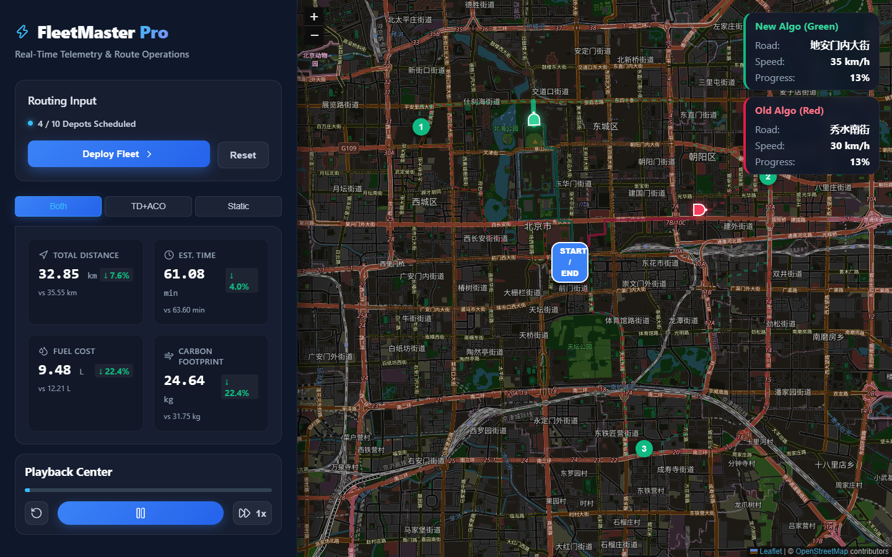

# 🚚 FleetMaster Pro — Traffic-Aware Green Route Planner

An interactive web app that plans delivery routes on Beijing's real road network and compares a **classical router** against our **traffic-aware, ACO-optimised router**, showing the savings in distance, time, fuel and CO₂.

🌐 **Live Demo:** [fleetmaster-api.vercel.app](https://fleetmaster-api.vercel.app/)



This is the deployed web application of our B.Tech project at **ABV-IIITM Gwalior**, *GNN-Enhanced ACO for Dynamic and Green Multi-Depot Vehicle Routing in Smart Cities*. The research code, models and paper are in **[BTP-Project](https://github.com/psp2535/BTP-Project)**.

---

## ✨ Key Features

- **Traffic-Aware Routing:** Uses predicted road congestion to calculate realistic travel times.
- **ACO-Based Optimisation:** Applies Max-Min Ant System (MMAS) to optimise delivery-stop ordering.
- **Real-World Road Network:** Uses OpenStreetMap data of central Beijing.
- **Route Comparison:** Compares classical and traffic-aware routing approaches.
- **Green Route Planning:** Estimates distance, travel time, fuel consumption and CO₂ emissions.
- **Interactive Visualisation:** Displays routes, road names, vehicle speeds and animated playback.

---

## 👥 Team

| Name | GitHub | LinkedIn |
|---|---|---|
| **Pathange Sai Pranav** | [@psp2535](https://github.com/psp2535) | [LinkedIn](https://www.linkedin.com/in/pathangesaipranav/) |
| **Chakali Surendra** | [@suri5790](https://github.com/suri5790) | [LinkedIn](https://www.linkedin.com/in/surendrachakali/) |
| **Duppala Satwik** | [@Satwik2529](https://github.com/Satwik2529) | [LinkedIn](https://www.linkedin.com/in/satwik2529dsk/) |
| **Gedela Sasidhar Chakrapani** | [@Sasidhar1906](https://github.com/Sasidhar1906) | [LinkedIn](https://www.linkedin.com/in/gedela-sasidhar-chakrapani-3b2124326/) |

**Supervisor:** Dr. Bhanu Chander, ABV-IIITM Gwalior

---

## 🗺️ How to Use

1. Open the [live demo](https://fleetmaster-api.vercel.app/).
2. **Click the map** to place the depot (first click), then up to 9 delivery stops. Keep points within central Beijing (roughly inside the 4th Ring Road).
3. Press **Deploy Fleet**.
4. Compare the two routes using **Both**, **TD+ACO** and **Static**. Use the **Playback Center** to animate vehicles and observe road names, speeds and progress.

> The backend runs on Render's free tier and sleeps when idle, so the first request can take approximately 40 seconds while it wakes up.

---

## ⚙️ How It Works

Both algorithms run on the real OpenStreetMap drive network of central Beijing (~15 × 15 km) and visit every stop before returning to the depot.

| | Old Algorithm (Red) | New Algorithm (Green) |
|---|---|---|
| **Path between stops** | Static Dijkstra (fixed road speeds) | Time-Dependent Dijkstra (congestion-aware road speeds) |
| **Stop order** | Greedy Nearest Neighbour | Max-Min Ant System (ACO) — 20 ants × 50 iterations |
| **Traffic awareness** | None | TCFMu XGBoost model trained on Microsoft T-Drive taxi GPS data |

For each route, the app reports **distance, travel time, fuel and CO₂**. Fuel uses a load- and speed-dependent model: consumption is lowest at 30–60 km/h and rises sharply in stop-and-go traffic.

```text
React + Leaflet UI (Vercel) ──POST /api/compare──▶ FastAPI backend (Render, Docker)
                                                    ├── OSMnx road graph
                                                    ├── TCFMu congestion predictions
                                                    ├── Static & Time-Dependent Dijkstra
                                                    └── Greedy vs MMAS-ACO stop ordering
```

---

## 🔬 Research Contributions

The project explores the integration of traffic prediction and intelligent optimisation for sustainable urban delivery routing.

- **Traffic Prediction:** Uses an XGBoost-based TCFMu model to estimate road congestion.
- **Intelligent Routing:** Combines MMAS-ACO with Time-Dependent Dijkstra for traffic-aware route planning.
- **Green Optimisation:** Considers fuel consumption and CO₂ emissions alongside distance and travel time.
- **Real-World Evaluation:** Uses an actual OpenStreetMap road network instead of a synthetic road network.

---

## 📊 Performance Evaluation

The two algorithms are compared using the following metrics:

| Metric | Description |
|---|---|
| Distance (km) | Total distance travelled |
| Travel Time (sec) | Estimated journey duration |
| Fuel (L) | Estimated fuel consumption |
| CO₂ (g) | Estimated carbon emissions |
| Average Congestion | Congestion experienced along the route |
| Runtime (sec) | Algorithm execution time |

Percentage savings are calculated as:

\[
\text{Savings (\%)} =
\frac{\text{Old Value}-\text{New Value}}
{\text{Old Value}}\times100
\]

---

## 🔌 API

### `POST /api/compare`

**Example Request:**

```json
{
  "depot": {
    "lat": 39.9042,
    "lon": 116.4074
  },
  "deliveries": [
    {
      "lat": 39.9289,
      "lon": 116.3883
    },
    {
      "lat": 39.8856,
      "lon": 116.4317
    }
  ]
}
```

All points must lie within **lat 39.83–39.97, lon 116.32–116.48**, otherwise the API returns `400`.

The response contains `old_algo` and `new_algo`, each containing:

- `metrics`: `distance_km`, `duration_sec`, `fuel_l`, `co2_g`, `avg_congestion`, `runtime_sec`.
- `ordered_indices`: The visiting order of the points.
- `segments`: Per-road-segment `name`, `length_m`, `duration_sec`, `speed_kmh` and `coords` for drawing and playback.

Interactive API documentation is served at `/docs` on the backend.

---

## 💻 Run Locally

**Backend** (Python 3.10+):

```bash
git clone https://github.com/psp2535/td-dijkstra-aco-router.git
cd td-dijkstra-aco-router
pip install -r requirements.txt
uvicorn api_server:app --port 8000
```

The Beijing road graph and congestion data are included in `data/processed/`, so no download is needed.

**Frontend** (Node.js 20.19+ or 22.12+), in a second terminal:

```bash
cd ui
npm install
npm run dev
```

Open the URL Vite prints (usually http://localhost:5173). The dev server forwards `/api` requests to the backend on port 8000.

---

## 🚀 Deployment

| Part | Platform | Setup |
|---|---|---|
| Frontend | **Vercel** | Root directory `ui`, build `npm run build`, output `dist`. Set `VITE_API_URL` to the backend URL. |
| Backend | **Render** | Built from the `Dockerfile`; listens on Render's `PORT`. |

Vercel redeploys the frontend on every push to `main`; Render does the same for the backend when auto-deploy is enabled.

---

## 📁 Repository Structure

```text
td-dijkstra-aco-router/
├── api_server.py              # FastAPI backend: /api/compare
├── Dockerfile                 # Backend container (Render)
├── requirements.txt           # Backend dependencies
├── src/models/
│   ├── osmnx_routing.py       # Static & time-dependent Dijkstra
│   ├── mmas_routing.py        # Max-Min Ant System
│   └── astar_routing.py       # A* routing
├── data/processed/            # Road graph, congestion predictions, fleet config
├── config/default_config.yaml # Grid and vehicle parameters
├── ui/                        # React 19 + Vite + React-Leaflet frontend
│   └── src/App.jsx             # Map, controls, metrics and playback
└── docs/screenshot.png
```

---

## 🛠️ Tech Stack

**Frontend:** React 19, Vite, Leaflet / React-Leaflet, Turf.js, Axios, Lucide icons.

**Backend:** FastAPI, Uvicorn, OSMnx, NetworkX, NumPy, Pandas.

**Algorithms:** Dijkstra, Time-Dependent Dijkstra, MMAS-ACO, Greedy Nearest Neighbour.

**Machine Learning:** XGBoost.

**Map Data:** © [OpenStreetMap](https://www.openstreetmap.org/copyright).

**Hosting:** Vercel (Frontend), Render (Backend).

---
