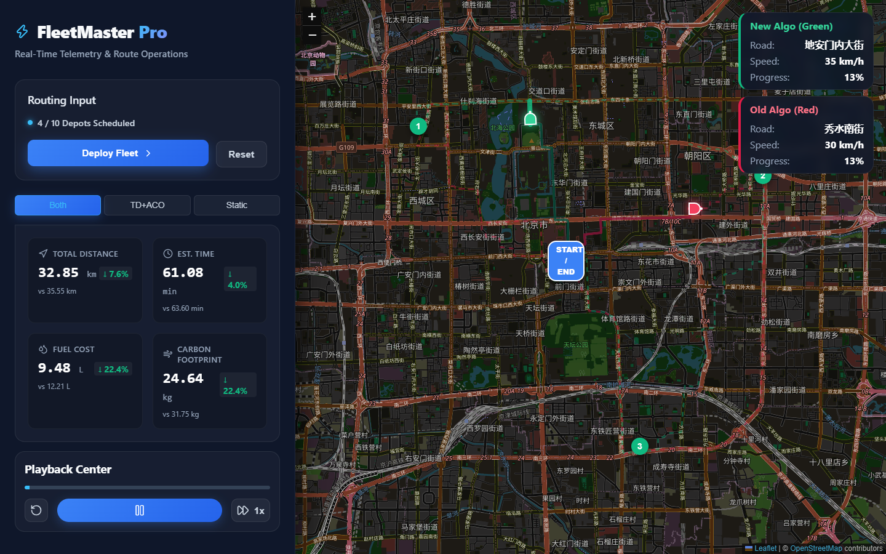

# FleetMaster Pro — Traffic-Aware Green Route Planner

An interactive web app that plans delivery routes on Beijing's real road network and compares a **classical router** against our **traffic-aware, ACO-optimised router**, showing the savings in distance, time, fuel and CO₂.

🌐 **Live demo:** [fleetmaster-api.vercel.app](https://fleetmaster-api.vercel.app/)



This is the deployed web application of our B.Tech project at **ABV-IIITM Gwalior**, *GNN-Enhanced ACO for Dynamic and Green Multi-Depot Vehicle Routing in Smart Cities*. The research code, models and paper are in **[BTP-Project](https://github.com/psp2535/BTP-Project)**.

---

## 👥 Team

| | Name | GitHub | LinkedIn |
|:-:|---|---|---|
|  | **Pathange Sai Pranav** | [@psp2535](https://github.com/psp2535) | [pathangesaipranav](https://www.linkedin.com/in/pathangesaipranav/) |
|  | **Chakali Surendra** | [@suri5790](https://github.com/suri5790) | [surendrachakali](https://www.linkedin.com/in/surendrachakali/) |
|  | **Duppala Satwik** | [@Satwik2529](https://github.com/Satwik2529) | [satwik2529dsk](https://www.linkedin.com/in/satwik2529dsk/) |

**Supervisor:** Dr. Bhanu Chander, ABV-IIITM Gwalior

---

## 🗺️ How to Use

1. Open the [live demo](https://fleetmaster-api.vercel.app/).
2. **Click the map** to place the depot (first click), then up to 9 delivery stops. Keep points within central Beijing (roughly inside the 4th Ring Road).
3. Press **Deploy Fleet**.
4. Compare the two routes. Switch between **Both**, **TD+ACO** and **Static**, and press play in the **Playback Center** to animate the vehicles with live road name, speed and progress.

> The backend runs on Render's free tier and sleeps when idle, so the **first request can take ~40 seconds** while it wakes up.

---

## ⚙️ How It Works

Both algorithms run on the real OpenStreetMap drive network of central Beijing (~15 × 15 km) and visit every stop before returning to the depot.

| | Old algorithm (red) | New algorithm (green) |
|---|---|---|
| **Path between stops** | Static Dijkstra (fixed road speeds) | **Time-dependent Dijkstra** — road speeds follow the congestion predicted for the departure hour (08:00) |
| **Stop order** | Greedy nearest-neighbour | **Max-Min Ant System (ACO)** — 20 ants × 50 iterations |
| **Traffic awareness** | None | Congestion predictions from our **TCFMu XGBoost** model, trained on Microsoft T-Drive taxi GPS data |

For each route the app reports **distance, travel time, fuel and CO₂**. Fuel uses a load- and speed-dependent model: consumption is lowest at 30–60 km/h and rises sharply in stop-and-go traffic, which is why avoiding congestion saves fuel.

```
 React + Leaflet UI (Vercel)  ──POST /api/compare──▶  FastAPI backend (Render, Docker)
                                                      ├─ OSMnx road graph of central Beijing
                                                      ├─ TCFMu congestion predictions
                                                      ├─ Static & time-dependent Dijkstra
                                                      └─ Greedy vs MMAS-ACO stop ordering
```

---

## 🔌 API

### `POST /api/compare`

```json
{
  "depot":      { "lat": 39.9042, "lon": 116.4074 },
  "deliveries": [ { "lat": 39.9289, "lon": 116.3883 },
                  { "lat": 39.8856, "lon": 116.4317 } ]
}
```

All points must lie within **lat 39.83–39.97, lon 116.32–116.48**, otherwise the API returns `400`.

The response has `old_algo` and `new_algo`, each containing:
- `metrics`: `distance_km`, `duration_sec`, `fuel_l`, `co2_g`, `avg_congestion`, `runtime_sec`
- `ordered_indices`: the visiting order of the points
- `segments`: per-road-segment `name`, `length_m`, `duration_sec`, `speed_kmh` and `coords` for drawing and playback

Interactive API docs are served at `/docs` on the backend.

---

## 💻 Run Locally

**Backend** (Python 3.10+):

```bash
git clone https://github.com/psp2535/td-dijkstra-aco-router.git
cd td-dijkstra-aco-router
pip install -r requirements.txt
uvicorn api_server:app --port 8000
```

The Beijing road graph and congestion data are included in `data/processed/`, so no download is needed.

**Frontend** (Node.js 20.19+ or 22.12+), in a second terminal:

```bash
cd ui
npm install
npm run dev
```

Open the URL Vite prints (usually http://localhost:5173). The dev server forwards `/api` requests to the backend on port 8000.

---

## 🚀 Deployment

| Part | Platform | Setup |
|---|---|---|
| Frontend | **Vercel** | Root directory `ui`, build `npm run build`, output `dist`. Set `VITE_API_URL` to the backend URL. |
| Backend | **Render** | Built from the `Dockerfile`; listens on Render's `PORT`. |

Vercel redeploys the frontend on every push to `main`; Render does the same for the backend when auto-deploy is enabled.

---

## 📁 Repository Structure

```
td-dijkstra-aco-router/
├── api_server.py              # FastAPI backend: /api/compare
├── Dockerfile                 # Backend container (Render)
├── requirements.txt           # Backend dependencies
├── src/models/
│   ├── osmnx_routing.py       # Static & time-dependent Dijkstra on the OSM graph
│   ├── mmas_routing.py        # Max-Min Ant System
│   └── astar_routing.py       # A* routing
├── data/processed/            # Road graph, congestion predictions, fleet config
├── config/default_config.yaml # Grid and vehicle parameters
├── ui/                        # React 19 + Vite + React-Leaflet frontend
│   └── src/App.jsx            # Map, controls, metrics and playback
└── docs/screenshot.png
```

---

## 🛠️ Tech Stack

**Frontend:** React 19, Vite, Leaflet / React-Leaflet, Turf.js, Axios, Lucide icons
**Backend:** FastAPI, Uvicorn, OSMnx, NetworkX, NumPy, pandas
**Map data:** © [OpenStreetMap](https://www.openstreetmap.org/copyright) contributors
**Hosting:** Vercel (frontend), Render (backend)
